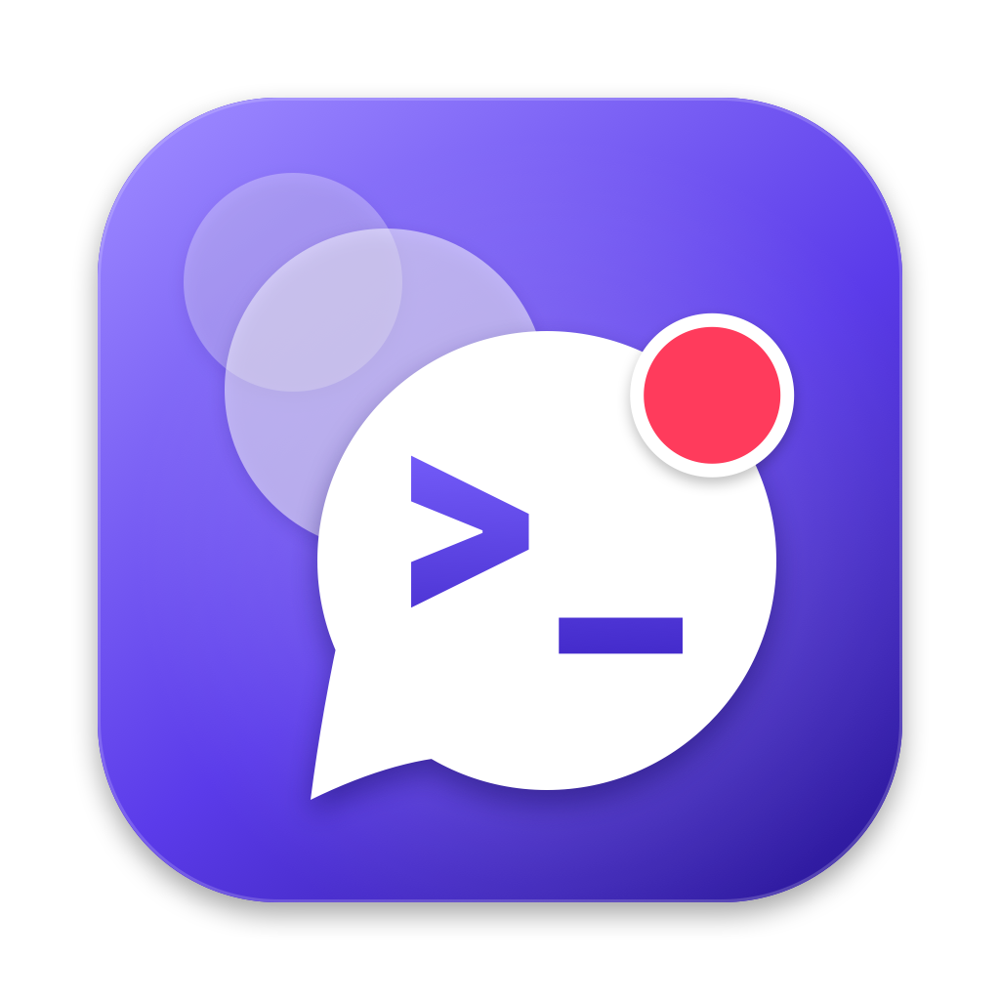
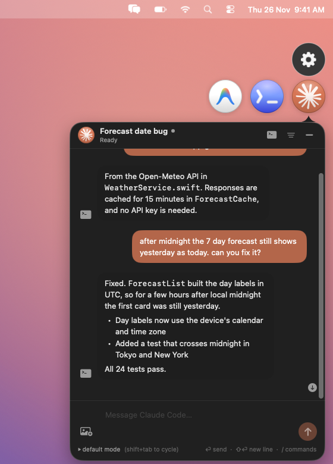

<p align="center">
  
</p>

<h1 align="center">CliHeads</h1>

<p align="center">
  Fb Messenger style chat heads for your favorite AI Agents.
</p>

<p align="center">
  
  
  
</p>

<p align="center">
  
  
</p>

Each chat head is a CLI session running in the background. Click a head to open the chat, drag it around and it snaps to the screen edge, drop heads on each other to stack them, fling one at the X to close it. When an agent replies you get the little preview bubble and an unread badge.

Works with:

- Claude Code (`claude`)
- Codex (`codex`)
- Gemini CLI (`gemini`)
- Grok (`grok`)

Each one runs through its own CLI, so install it and sign in from Terminal first. No API keys go through the app. CliHeads finds the CLIs on the same PATH your login shell uses, so installs through Homebrew, npm, nvm, bun or volta all work. CLIs it can't find show as "not installed" in the menu.

## Features

- the cog beside the heads starts a new chat with any agent, in any folder, or resumes an old one
- streaming replies with thinking shown above them
- click a code block to copy it
- paste or drop images into the chat
- shift+tab cycles permission modes (whatever the CLI supports)
- type while it's working and the message queues for after the turn
- `/resume` to pick an older conversation, `/clear` to start fresh
- Full CLI button swaps the chat for the real terminal UI, and back
- new heads pick up the latest conversation for that folder
- launch at login from the menu bar icon
- respects `CLAUDE_CONFIG_DIR` if you keep Claude's config somewhere else

## Download

Grab `CliHeads-<version>.dmg` from the [latest release](https://github.com/mkayultrah/CliHeads/releases/latest), open it and drag `CliHeads.app` onto the Applications folder. Runs on Apple silicon and Intel, macOS 14 or newer.

The app isn't notarised by Apple, so the first time you open it macOS will say it can't verify it. Either:

- open System Settings > Privacy & Security, scroll down and click **Open Anyway**, or
- run `xattr -dr com.apple.quarantine /Applications/CliHeads.app` in Terminal, then open it normally.

## Permissions

CliHeads doesn't ask for Accessibility, Screen Recording, Input Monitoring, camera, microphone or notifications. The app makes no network requests of its own; each CLI talks to its own service using the sign-in you set up in Terminal. Here's what you might see:

- **"Apple could not verify CliHeads" on first launch.** The DMG isn't notarised, see Download above.
- **Login Items.** Only if you turn on launch at login from the menu bar icon. CliHeads registers itself with macOS, which shows a "Background item added" notice. Turn it off from the same menu or System Settings > General > Login Items.
- **Desktop, Documents, Downloads, iCloud Drive or external drives.** The agents run as child processes of CliHeads, so when one reads or writes in a protected folder macOS asks on CliHeads' behalf. Allow it if you want agents working there. You can change it later in System Settings > Privacy & Security > Files and Folders.

Picking a folder for a new chat uses the standard macOS folder picker and just tells the agent where to start. Clicking outside an open chat closes it; that uses a plain mouse-click listener, which doesn't need any permission.

## Build

Needs macOS 14 or newer and the Xcode command line tools (`xcode-select --install`).

```sh
./build.command
```

That builds `dist/CliHeads.app`, quits any running copy and opens the new one. To just build without opening it:

```sh
./Scripts/make-app.sh               # this Mac's arch, signed ad hoc
UNIVERSAL=1 ./Scripts/make-app.sh   # arm64 + x86_64
./Scripts/make-dmg.sh               # wrap dist/CliHeads.app in dist/CliHeads-<version>.dmg
```

The icon is drawn in code. To change it, edit `Scripts/make-icon.swift` and run `swift Scripts/make-icon.swift`.

Heads, history and positions are saved in `~/Library/Application Support/CliHeads/heads.json`.

## Release

Needs a Developer ID Application certificate. Store notary credentials once with `xcrun notarytool store-credentials`, then:

```sh
CODESIGN_IDENTITY="Developer ID Application: Your Name (TEAMID)" \
NOTARY_PROFILE=your-profile \
./Scripts/release.sh
```

You get a signed, notarised, universal `dist/CliHeads-<version>.zip`. Leave out `NOTARY_PROFILE` to skip notarising. The version comes from `Info.plist`.

Without a Developer ID, `UNIVERSAL=1 ./Scripts/make-app.sh && ./Scripts/make-dmg.sh` gives an ad hoc signed DMG. That's how the current GitHub release is built, hence the Gatekeeper steps under Download.

## Tests

```sh
for t in syntax protocol agents magnets previews stacks; do ./Scripts/test-$t.sh; done
```

## Thanks

The spring feel is based on Facebook's [Rebound](https://github.com/facebookarchive/rebound) (BSD). Also looked at [brutella/chatheads](https://github.com/brutella/chatheads) and [BubbleControl-Swift](https://github.com/cemolcay/BubbleControl-Swift). The Full CLI view uses [SwiftTerm](https://github.com/migueldeicaza/SwiftTerm) (MIT, see `THIRD_PARTY_NOTICES`).

Claude, Codex, Gemini, Grok, Facebook and Messenger names and logos are trademarks of their owners. CliHeads is an independent project and isn't affiliated with or endorsed by Anthropic, OpenAI, Google, xAI or Meta.

## License

MIT
